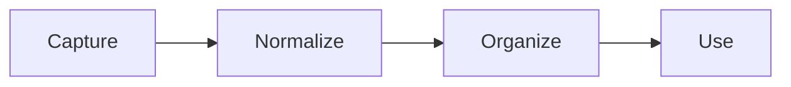

# Personal Knowledge Base

This repository is my personal "second brain".

## Purpose
- Capture and organize knowledge across projects
- Provide structured, searchable content for AI tools
- Maintain a historical record of decisions and learning

## Principles
- Markdown-first
- Structured notes over raw dumps
- One source of truth per concept
- AI-friendly formatting

## Key Areas
- `/inbox` → raw captured input
- `/daily` → daily logs
- `/projects` → project summaries
- `/topics` → long-lived knowledge
- `/patterns` → reusable ideas
- `/templates` → standard formats

## Workflow
1. Capture → inbox
2. Normalize with AI
3. Move to proper location
4. Commit frequently

---

    NOTE: remove below after cloning

# How to Use this Template Repository

## 🚀 Getting Started

1. On GitHub, above the file list, click **"Use this template"**
2. Select **Create a new repository**
3. Use the **Owner** dropdown menu to select the account you want to own the repository
4. Type a name for your repository, and an optional description
5. Choose **Private** for your repository visibility
6. Click **Create repository from template**
7. Clone your new repository locally:
```sh
git clone https://github.com/<your-username>/<your-repo>.git
```
8. Open the repository in VS Code (or your preferred editor)
9. Start by creating your first:
    * Daily note (/daily)
    * Inbox entry (/inbox)

## 🧭 Recommended Workflow
This repository is designed around a simple, repeatable workflow:



### 1. Capture
Add raw information to `/inbox`:

* Email summaries
* Teams discussions
* Ideas
* Debugging notes

### 2. Normalize (with AI)
Use GitHub Copilot or your preferred AI tool to convert raw input into structured markdown.

Example prompt:

```
Convert this into structured markdown with context, decisions, and action items.
```

### 3. Organize
Move notes to appropriate locations:

|Type|Location|
|----|--------|
|Daily work|`/daily`|
|General notes|root or future `/topics`|
|Project summaries|`/projects`|
|Reusable ideas|`/patterns` (when it emerges)|

### 4. Use

* Search across your knowledge base
* Reference notes while working
* Let AI assist with summaries, decisions, and documentation


## 🤖 Using AI Effectively
This repository is optimized for AI-assisted workflows.

### Tips:

* Use clear headings (## Context, ## Decisions, etc.)
* Keep notes concise and structured
* Maintain the AI_CONTEXT.md file

### Common Prompts:

* "Summarize this note"
* "Identify missing information"
* "Convert this into an ADR"
* "Generate a mermaid diagram from this"

### 📂 Folder Guidelines

* `/inbox` → temporary staging (process regularly)
* `/daily` → chronological work log
* `/templates` → reusable note formats
* `/projects` → high-level summaries
* `/topics` → create when patterns emerge
* `/patterns` → reusable solutions (create later)

#### 👉 Important: Do not pre-create structure unnecessarily — let it evolve.

### 🔄 Maintenance

* Process inbox regularly (daily or weekly)
* Refactor notes as understanding improves
* Promote important notes into structured formats (e.g., ADRs)
* Keep content clean and searchable

### 🎯 Philosophy

* Markdown-first
* Structure over storage
* One source of truth per idea
* Optimize for search and AI, not manual browsing

### ✅ Suggested First Steps

* Create your first daily note
* Add one real item to `/inbox`
* Use AI to structure and organize it
* Commit your changes

## 🧠 Final Thought
This repository is not just for storing information —
it is a system for **thinking, learning, and building better solutions over time.**
